# My School Color Point — инструкция

Дополнение (userscript для Tampermonkey) для учителей на платформе «Моя школа». Красит журнал, помогает ставить оценки и комментарии, берёт на себя рутину при выдаче домашнего задания и показывает расписание коллег.

> **О скриншотах.** Все снимки сделаны на странице-макете с вымышленными учениками и оценками (в нижней части кадра подпись «Макет страницы с вымышленными данными»). Настоящие журналы и данные учеников в них не попали. Внешний вид самого сайта на макете упрощён, а окна и кнопки дополнения настоящие.

Установка и обновление описаны в [README](../README.md). Все настройки открываются кнопкой с шестерёнкой и кисточкой рядом с названием журнала (на странице расписания она справа от переключателя недель). Любое изменение в настройках сохраняется и применяется сразу, кнопки «Применить» нет. Настройки лежат в `localStorage` браузера, поэтому на другом компьютере или в другом браузере их нужно задать заново.

## Содержание

1. [Журнал: цвета и подсказки](#1-журнал-цвета-и-подсказки)
2. [Формы контроля «только в день урока»](#2-формы-контроля-только-в-день-урока)
3. [Карточка оценки: быстрые комментарии](#3-карточка-оценки-быстрые-комментарии)
4. [Вызов к доске](#4-вызов-к-доске)
5. [Выдача домашнего задания на сайте](#5-выдача-домашнего-задания-на-сайте)
6. [Окно «Уроки дня»: ДЗ и комментарии](#6-окно-уроки-дня-дз-и-комментарии)
7. [Расписание: виды, коллеги и классы](#7-расписание-виды-коллеги-и-классы)
8. [Прочее: токен, дополнения](#8-прочее-токен-дополнения)
9. [Справочник настроек](#9-справочник-настроек)

---

## 1. Журнал: цвета и подсказки

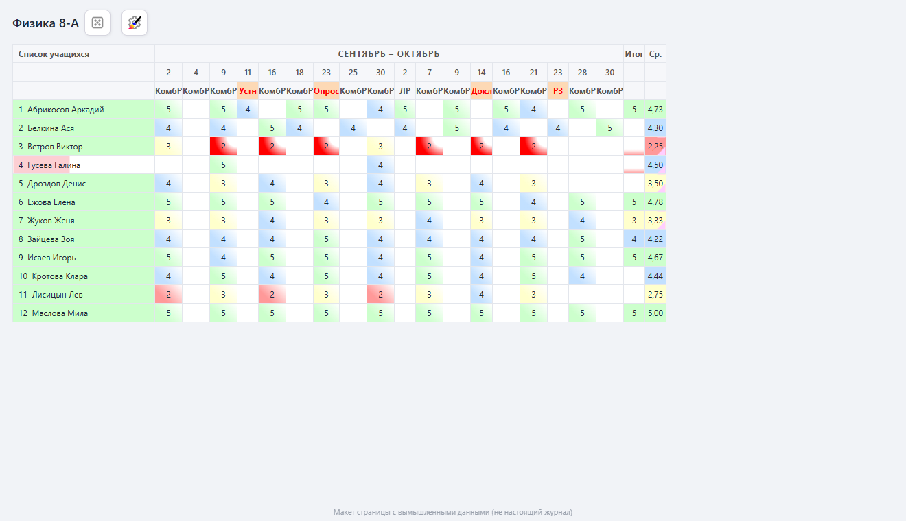

Работает на страницах журнала (`Журналы классов → журнал`). Каждая подсветка включается отдельным тумблером на вкладке **Журнал → Цветной режим**.

| Что | Как выглядит | Что значит |
|---|---|---|
| **Оценки за уроки** | ячейка с мягкой заливкой: зелёная — 5, голубая — 4, жёлтая — 3, красная — 2 | быстро видно, где слабые места |
| **Цепочка двоек** | ярко-красная ячейка с красным уголком | три и более двойки подряд (пустые уроки цепочку не прерывают) |
| **Накопляемость оценок** | цветная полоса у имени ученика | сколько оценок уже есть из нужного для аттестации |
| **Итоговая ячейка** | красная полоса снизу | оценок недостаточно или последняя оценка 2 |
| **Средний балл** | цвет по правилам округления | оценка, которая должна получиться по среднему баллу |
| **Пограничные оценки** | цветной уголок в ячейке среднего балла | до следующей оценки не хватает одной-двух оценок |

**Сколько оценок нужно.** Ячейка «Итог» и полоса у имени сравнивают число оценок с нормой для аттестации: 3 оценки, если уроков в периоде меньше 15, и 5 оценок, если 15 и больше. Эти числа показывает вкладка **Журнал** вверху окна настроек: уроков в триместре, нужно оценок, вид округления.

**Округление среднего балла.**

| Округление | 5 | 4 | 3 | 2 |
|---|---|---|---|---|
| Лицейское (по умолчанию) | от 4,65 | от 3,6 | от 2,6 | ниже 2,6 |
| Математическое (ИЗО, Музыка, Труд, Физкультура) | от 4,5 | от 3,5 | от 2,5 | ниже 2,5 |

**Уголок и подсказка.** Если до следующей оценки не хватает одной-двух оценок, в ячейке среднего балла появляется уголок, а при наведении всплывает подсказка с минимальным вариантом. Серый уголок означает, что средний балл на сайте не сходится с подсчётом по оценкам на экране (например, часть оценок скрыта фильтром).

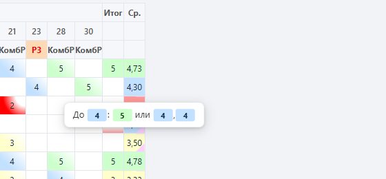

На снимке у Дроздова Дениса средний 3,50: чтобы получить «4», ему нужна одна пятёрка.

### Настройки журнала

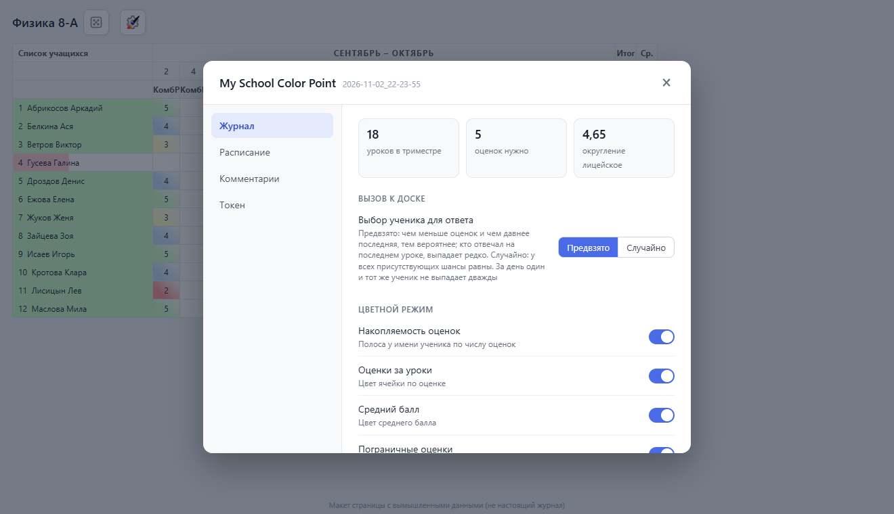

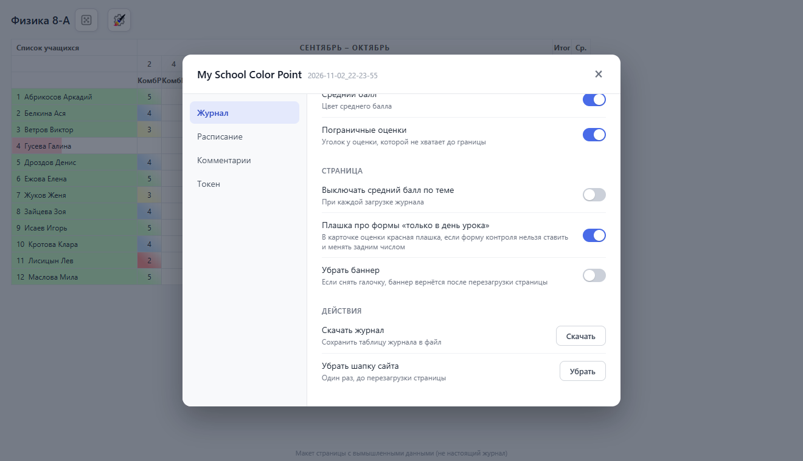

- **Выключать средний балл по теме** — при каждой загрузке журнала дополнение само отключает на сайте показ среднего балла по теме и по контрольным (без него не работает определение числа оценок). Включено по умолчанию на настоящем сайте.
- **Плашка про формы «только в день урока»** — см. раздел 2.
- **Убрать баннер** — прячет рекламный баннер и освобождает место под таблицу.
- **Скачать журнал** — сохраняет таблицу журнала в файл.
- **Убрать шапку сайта** — один раз, до перезагрузки страницы, убирает верхнюю шапку сайта и добавляет место таблице.

> **Важно.** Раскраска считает по тому, что показано на экране. Если журнал отображается за несколько периодов сразу или в нём включён средний балл по теме, число оценок для аттестации определяется неточно.

---

## 2. Формы контроля «только в день урока»

Для ряда форм контроля сайт не разрешает ставить и менять оценку задним числом. Дополнение показывает это в двух местах.

### Шапка журнала

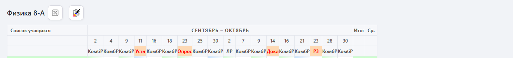

Под датой урока в шапке журнала стоит сокращённое название формы контроля. Если форма «только в день урока», сокращение выделяется красным шрифтом на оранжевом фоне. На снимке такие формы: `Устн` (устный ответ), `Опрос`, `Докл` (доклад), `РЗ` (решение задач). `КомбР` (комбинированная работа) и `ЛР` (лабораторная работа) задним числом менять можно.

Подсвечиваются все 18 форм: Выразительное чтение (`ВрзЧт`), Диалог/полилог (`Диалог`), Доклад (`Докл`), Зачет (`Зачет`), Монолог (`Монол`), Опрос (`Опрос`), Пересказ (`Переск`), Письменный ответ (`ПО`), Решение задач (`РЗ`), Смысловое чтение (`СмысЧт`), Тестирование физических качеств (`ТестФК`), Техника чтения (`ТехЧт`), Устный ответ (`Устн`), Устный счет (`УСчет`), Учебная работа (`УР`), Учебное задание (`УчЗ`), Учебное упражнение (`Упр`), Чтение (`Чт`).

### Плашка в карточке оценки

Если вы открыли карточку оценки на уже прошедший урок и выбрали в ней форму из этого списка, наверху карточки появляется яркая красная плашка с датой урока. Плашка пропадает, как только вы выберете другую форму. Она только предупреждает и сохранение не блокирует.

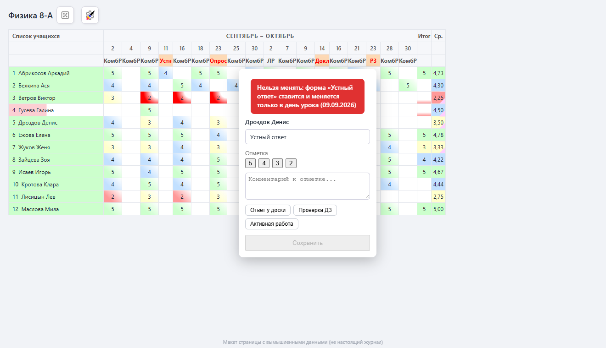

То же в расширенной карточке (боковая панель):

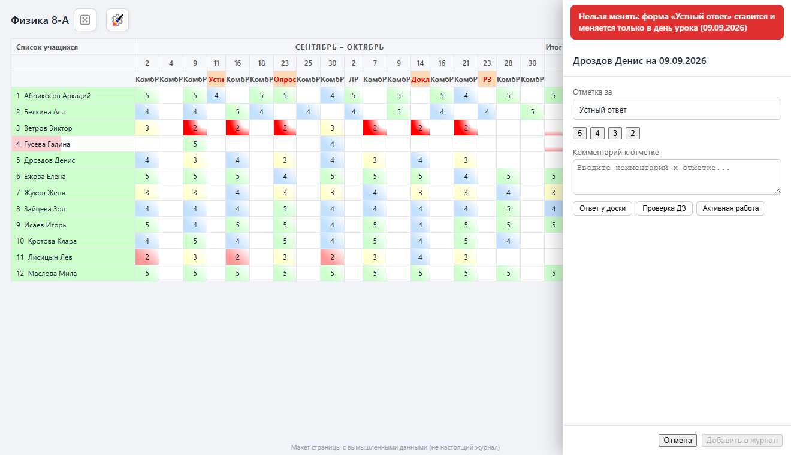

Отключается тумблером **Журнал → Страница → Плашка про формы «только в день урока»**.

---

## 3. Карточка оценки: быстрые комментарии

Кнопки быстрых комментариев появляются под полем комментария и в быстрой карточке (всплывающая у ячейки), и в расширенной (боковая панель «Отметки ученика»). **По умолчанию кнопок нет**: список вы составляете сами.

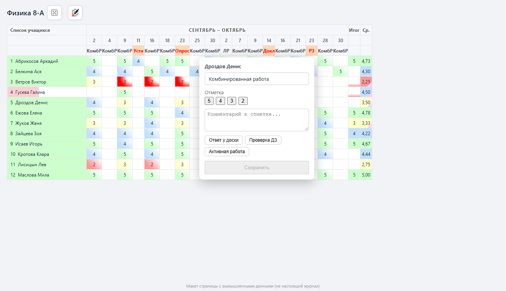

Нажатие на кнопку подставляет её текст в поле комментария (прежний текст заменяется).

### Свои кнопки

Настройки → вкладка **Комментарии**.

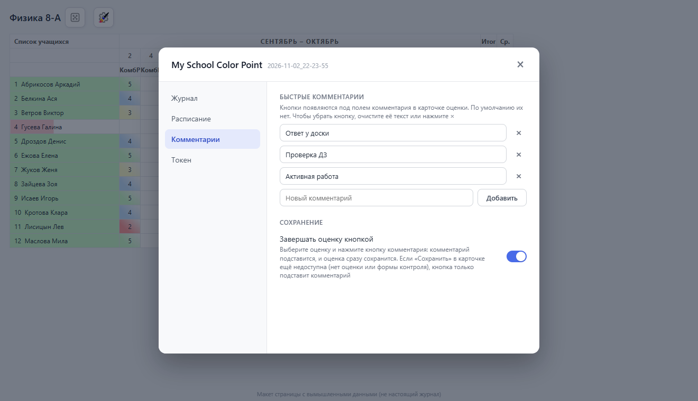

- **Добавить:** введите текст в нижнее поле и нажмите **Добавить** или Enter.
- **Изменить:** поправьте текст прямо в строке; изменение сохраняется, когда вы уходите из поля.
- **Удалить:** кнопка **×** или очистка текста.
- Одинаковые тексты не дублируются, длина одного комментария ограничена 300 символами.

Список хранится в `localStorage`, поэтому у каждого браузера он свой.

### Завершать оценку кнопкой

Тумблер **Завершать оценку кнопкой** (на той же вкладке) ускоряет проставление оценки до двух нажатий:

1. Выберите оценку в карточке.
2. Нажмите кнопку комментария. Текст подставится, и карточка сразу сохранится (**Сохранить** в быстрой, **Добавить в журнал** в расширенной).

Если кнопка сохранения ещё недоступна (не выбрана оценка или форма контроля), кнопка комментария только подставит текст. Если у карточки несколько отметок («Еще отметка»), сохранятся все.

---

## 4. Вызов к доске

Кнопка с игральным кубиком рядом с названием журнала выбирает ученика для ответа. Выбранный ученик подсвечивается в таблице.

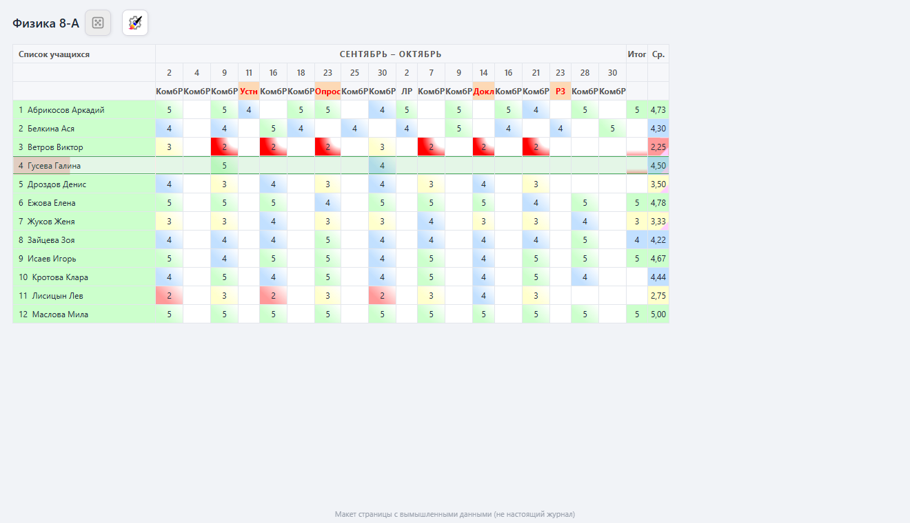

- **Повторное нажатие** на кнопку снимает подсветку и отмечает ученика как названного: сегодня он больше не выпадет.
- **Отсутствующие** (отметка «Н» на сегодня) не выбираются.
- **Режимы** (Журнал → Вызов к доске):
  - **Предвзято** (по умолчанию): чем меньше у ученика оценок и чем давнее последняя, тем он вероятнее; те, кто отвечал на последнем уроке, выпадают редко.
  - **Случайно**: у всех присутствующих шансы равны.
- За день один и тот же ученик не выпадает дважды; состояние дня сохраняется при перезагрузке страницы. Если все присутствующие уже названы, дополнение сообщит об этом.

---

## 5. Выдача домашнего задания на сайте

Окно сайта «Домашнее задание к уроку» дополнение избавляет от лишних нажатий. Настройки: вкладка **Расписание → Выдача домашнего задания**.

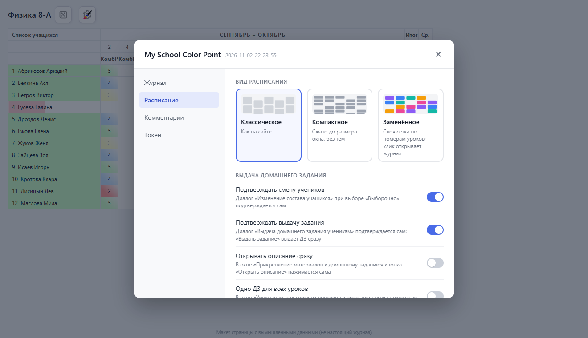

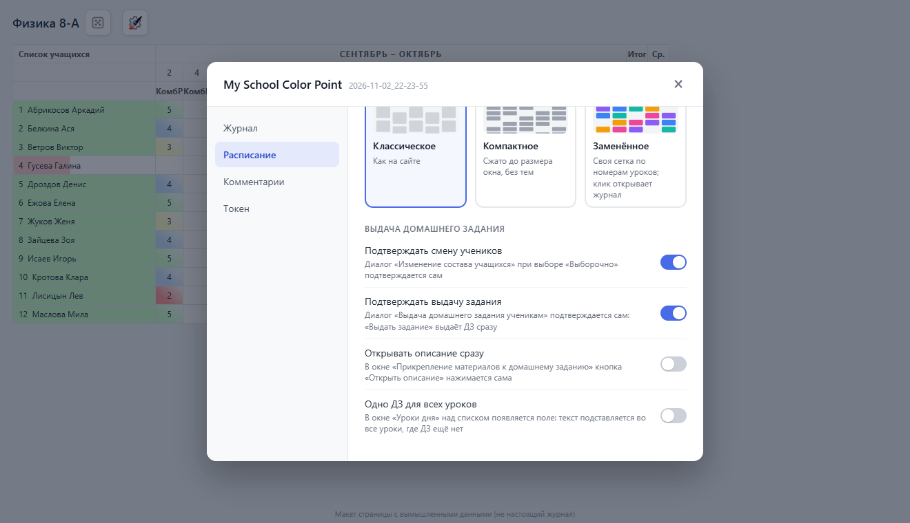

| Пункт | По умолчанию | Что делает |
|---|---|---|
| **Подтверждать смену учеников** | включено | Когда вы выбираете **Выборочно**, сайт спрашивает «Хотите сформировать домашнее задание другой группе учеников?». Дополнение само нажимает **Подтвердить** |
| **Подтверждать выдачу задания** | включено | После **Выдать задание** сайт переспрашивает «Вы уверены, что хотите выдать…». Дополнение само нажимает **Выдать домашнее задание** |
| **Открывать описание сразу** | выключено | В окне «Прикрепление материалов к домашнему заданию» кнопка **Открыть описание** нажимается сама |

Кроме автонажатий, дополнение чинит расположение окон: диалог «Изменение состава учащихся» раньше оказывался **под** окном выбора учащихся, теперь он поверх.

> **Осторожно с «Подтверждать выдачу задания».** При включённом пункте ДЗ выдаётся сразу после **Выдать задание**, второго вопроса не будет. Если боитесь случайного нажатия, выключите его.

---

## 6. Окно «Уроки дня»: ДЗ и комментарии

Открывается кнопкой с карандашом на странице **Расписание уроков** (рядом с переключателем недель). Позволяет выдать домашнее задание сразу на все уроки дня и поставить комментарии, не заходя в каждый журнал.

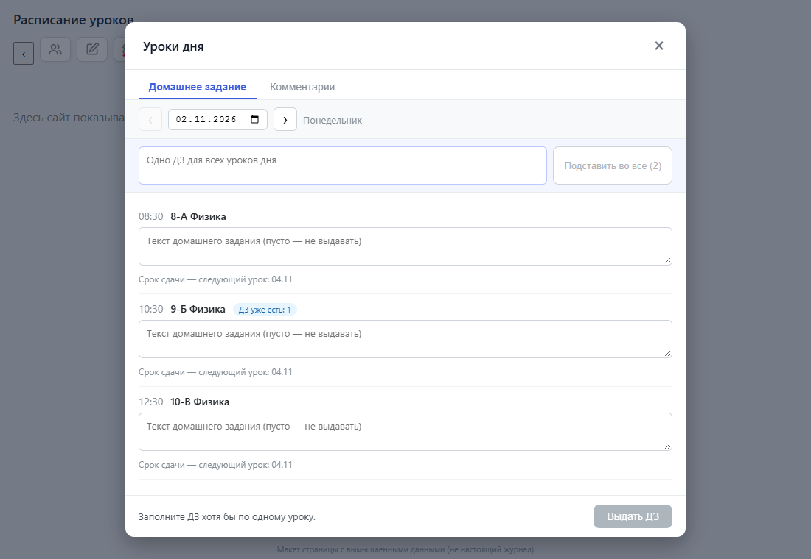

### Домашнее задание

- Вверху дата (по умолчанию сегодня), стрелки перелистывают дни. **Раньше сегодняшнего дня выдать нельзя**: сайт не принимает ДЗ задним числом.
- На каждый урок дня своя карточка: время, класс, предмет и поле для текста. **Пустое поле — ДЗ на этом уроке не выдаётся.**
- **Срок сдачи** — ближайший следующий урок этой группы (показан под полем). Время выполнения — 15 минут. Менять их в окне нельзя.
- Если на уроке ДЗ уже есть, рядом с названием синий значок «ДЗ уже есть: N», а при наведении виден текст. Новый текст не перезаписывает прежний, а создаёт ещё одно ДЗ.
- **Выдать ДЗ** отправляет задания по одному запросу на урок, результат виден у каждого урока («выдано» или причина ошибки). Ошибка одного урока остальные не останавливает.
- Уроки группы, которой нет в вашем списке групп (например, подгруппа без состава), выдать отсюда нельзя: окно подскажет выдать ДЗ в журнале.

### Одно ДЗ для всех уроков

Необязательная панель над списком включается в **Расписание → Выдача домашнего задания → Одно ДЗ для всех уроков** (по умолчанию выключена).

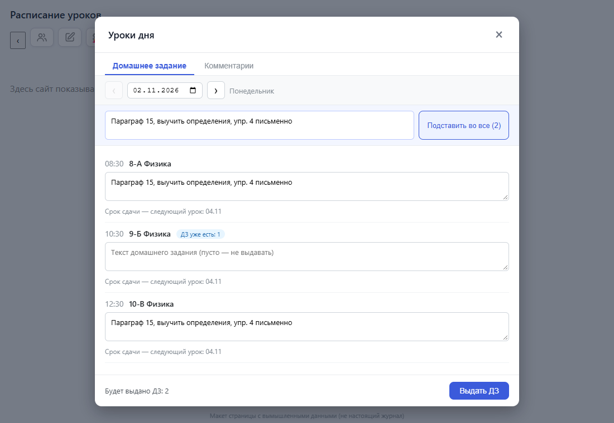

Введите текст и нажмите **Подставить во все** (или Ctrl+Enter). Текст попадёт в поля всех уроков, где можно выдать ДЗ. Дальше его можно поправить у отдельных уроков, затем нажать **Выдать ДЗ** как обычно. В скобках на кнопке указано, во сколько уроков текст встанет.

Пропускаются:
- уроки, на которых ДЗ уже есть (в том числе показанные значком «ДЗ уже есть»);
- уроки без группы или без следующего урока (нет срока сдачи);
- уроки, на которых ДЗ уже выдано в этом окне, чтобы не получить дубль.

Текст в полях уроков при подстановке заменяется на общий.

### Комментарии

Вторая вкладка ставит **один комментарий случайному ученику группы** на каждый отмеченный урок. Нужна, когда по регламенту у урока должна быть запись, а оценок нет.

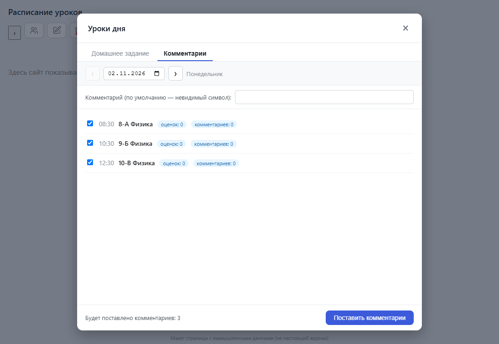

- В поле сверху текст комментария. По умолчанию это **невидимый символ**: сайт принимает его как текст, а ученик видит пустое место.
- Галочки стоят по умолчанию на уроках, где **нет ни оценок, ни комментариев**; повторный запуск комментарии не плодит.
- Если сайт не ответил и число оценок/комментариев неизвестно, урок не отмечается автоматически.

---

## 7. Расписание: виды, коллеги и классы

Относится к странице **Расписание уроков**. Скриншоты этого раздела в инструкцию не вошли: для них нужна полная сетка расписания сайта.

### Вид расписания

Настройки → вкладка **Расписание → Вид расписания** (см. снимок настроек в разделе 5). Три карточки:

- **Классическое** — как на сайте, без изменений.
- **Компактное** — страница сжимается так, чтобы целиком помещаться в окно: без шкалы времени и тем уроков, остаются время, кабинет и значки урока и ДЗ.
- **Заменённое** (по умолчанию) — своя сетка по номерам школьного звонка. Клик по карточке открывает журнал.

У заменённого вида есть дополнительные параметры:

- **Предмет на карточке:** цвет (полоска слева), подпись, цвет и подпись или не помечать (если предмет один, он не помечается);
- **Цвет класса** — у одинаковых классов одинаковый цвет;
- **Время урока** — начало и конец урока на карточке.

Значки **У** (оценки) и **ДЗ** на карточке урока: зелёный — есть, красный — нет, серый — срок ещё не вышел; голубое **У** — оценок нет, но есть комментарий. Подробности при наведении.

### Расписание коллег и классов

Кнопка с двумя силуэтами рядом с переключателем недель открывает окно.

- Переключатель **Учителя | Классы**, ниже список с поиском и закреплением (закреплённые и последний выбранный запоминаются).
- Справа сетка недели: дни и номера уроков школьного звонка. У учителя в занятой ячейке указаны класс и предмет, у класса — предмет и учитель (подгруппы идут друг под другом). **Свободное время зелёное.**
- Режим **«Свободны вместе со мной»** берёт ваше расписание и выделяет часы, свободные у обоих. Удобно, чтобы договориться о замене или встрече.
- Окно открывается на неделе, выбранной на странице расписания; недели листаются в самом окне.
- «Свободно» значит «нет урока в расписании»: внеурочка, дежурства и совещания не учитываются.
- Список учителей обновляется раз в неделю, будущие недели — раз в несколько часов; прошедшие недели из кеша не обновляются.

---

## 8. Прочее: токен, дополнения

### Токен для школьного журнала

Настройки → вкладка **Токен**.

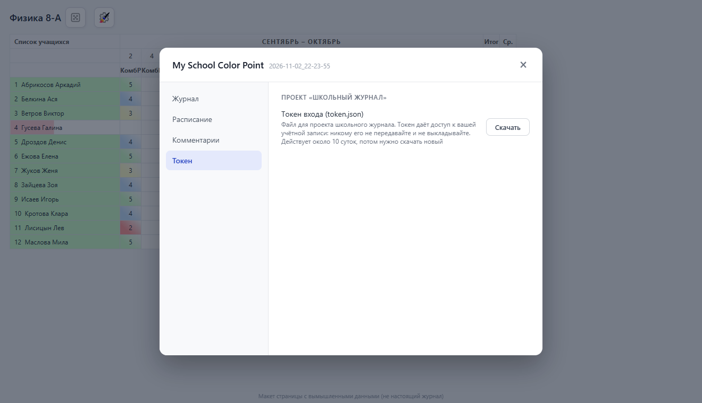

Кнопка **Скачать** сохраняет файл `token.json` для проекта «Школьный журнал» (`{"aupd_token": ..., "profile_id": ...}`). Токен действует около 10 суток, потом нужно скачать новый; кнопка показывает, сколько суток осталось. **Токен даёт доступ к вашей учётной записи: никому его не передавайте и не выкладывайте.**

### Дополнения

Другие userscript могут сообщить дополнению о себе: тогда в настройках появляется вкладка **Дополнения** со статусом подключения (работает / есть замечание / ошибка / проверяется) и кнопкой «Проверить сейчас». Протокол обмена описан в [README](../README.md#дополнения). Пока ни одно дополнение не подключено, вкладки нет.

---

## 9. Справочник настроек

| Вкладка | Настройка | По умолчанию |
|---|---|---|
| Журнал | Выбор ученика для ответа: предвзято / случайно | предвзято |
| Журнал | Накопляемость оценок, оценки за уроки, средний балл, пограничные оценки | включено |
| Журнал | Выключать средний балл по теме | включено |
| Журнал | Плашка про формы «только в день урока» | включено |
| Журнал | Убрать баннер | выключено |
| Расписание | Вид расписания | заменённое |
| Расписание | Предмет на карточке / цвет класса / время урока (только у заменённого вида) | цвет / да / да |
| Расписание | Подтверждать смену учеников | включено |
| Расписание | Подтверждать выдачу задания | включено |
| Расписание | Открывать описание сразу | **выключено** |
| Расписание | Одно ДЗ для всех уроков | **выключено** |
| Комментарии | Быстрые комментарии | **пусто** |
| Комментарии | Завершать оценку кнопкой | выключено |

---

## Для разработчиков: как обновить скриншоты

Скриншоты делает скрипт [`tools/screenshots/shoot.py`](../tools/screenshots/shoot.py): он открывает настоящий `script.js` в Chrome на странице-макете (адрес `authedu.mosreg.ru` подменяется локально, в сеть ничего не уходит) и сохраняет PNG без сжатия в `docs/screens/`.

```bash
./build.sh                              # собрать script.js
pip install playwright                  # один раз; нужен установленный Chrome
python tools/screenshots/shoot.py
```

Вымышленные ученики, оценки и ответы API описаны в начале `shoot.py`. Если сайт изменит разметку, макет придётся поправить.
